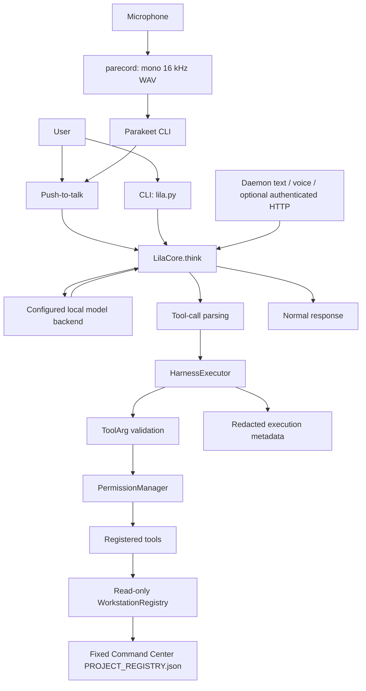

# Lila Architecture

## What Lila is

Lila is a local assistant runtime. The active application is Python: `LilaCore`
owns model inference and conversation orchestration, and `HarnessExecutor`
owns all registered tool execution. The C code in `engine/` is a separate
inference-engine project; the current `LilaCore` does not load it.

Lila can accept typed input in the CLI, push-to-talk transcripts in the CLI or
daemon, and optionally authenticated HTTP text input when explicitly enabled.
All these paths converge on `LilaCore.think()`. The CLI and daemon do not have
separate tool executors.

Workstation tools are an optional personal extension, disabled by default
with `LILA_WORKSTATION_ENABLED`. The Windows tray, WSL supervisor, and global
keyboard voice client are implemented; their setup and current behavior are
documented in [`docs/voice-input`](./voice-input/README.md),
[`WINDOWS_CLIENT_INTEGRATION.md`](./WINDOWS_CLIENT_INTEGRATION.md), and
[`LILA_SERVICE_OPERATIONS.md`](./LILA_SERVICE_OPERATIONS.md).

## Runtime shape

## Main components

### LilaCore

`src/core/lilacore.py` loads a local model and keeps the conversation history.
Supported runtime branches are `llama-cpp-python` for GGUF and Transformers for
Hugging Face-compatible models. When no backend is configured, inference
fails explicitly; there is no real API provider implemented in the fallback
path.

At boot, LilaCore registers system and extended tools, and registers
workstation tools only when explicitly enabled, then constructs the single
`HarnessExecutor`. It parses generated tool calls,
submits them to the executor, appends bounded execution results to the model
context, and asks the model to produce its normal response. Tool execution is
limited to three rounds per response.

Memory operations and memory tools are unavailable in the active runtime.
Interaction logging currently persists user and assistant text to
`logs/interactions.jsonl`; voice transcripts therefore also appear there.

### Harness and permissions

`src/harness/tools.py` defines tool schemas, the shared registry, result
formatting, and tool-call parsing. The parser accepts the supported JSON/XML
and legacy call forms. `src/harness/executor.py` validates required,
optional, unknown, and typed arguments before authorizing a call. It records
execution metadata and formats results for LilaCore.

`src/harness/permissions.py` is the central risk policy. Known low-risk
read-only operations, including the six `workstation_*` registry tools, are
automatic. Approval-required operations need an approval callback; without
one, they are denied. Memory operations are disabled, and unrecognized tools
require approval. The CLI supplies an interactive owner-approval callback;
the daemon does not.

Harness logs contain tool names, time, outcome, duration, permission decision,
and redaction placeholders rather than tool payloads or result contents.
This does not change LilaCore's separate interaction log, which retains
conversation text. Interaction and Harness log directories are secured to
POSIX `0700` and their files to `0600`; these modes do not encrypt data and
depend on filesystem support. See [system design](./LILA_SYSTEM_DESIGN.md) for
access and retention limits.

### Workstation awareness

When enabled, `src/workstation/registry.py` reads only the authoritative
`/mnt/c/Workstation/00_Command_Center/PROJECT_REGISTRY.json`. Production callers
cannot choose a registry path. Validation checks schema, field types,
references, and trusted path boundaries rooted at `/home/ticket/workspaces`.
The fixed registry is the only source of workstation registration data.

`src/workstation/tools.py` exposes bounded, read-only metadata operations:
overview, categories, workspaces, one workspace by registered name, intake
settings, and software-location settings. They do not inspect arbitrary files,
enumerate arbitrary directories, or verify that every declared path currently
exists. Registry declarations and live filesystem observations are distinct.

### Voice

`src/core/voice.py` captures a completed utterance with `parecord`, transcribes
it using the external Parakeet CLI, saves the WAV and the raw transcript outside
the Git repository, then passes that exact transcript to the caller. The CLI
callback calls `LilaCore.think()`; the daemon callback does the same. See
[LILA_VOICE_ARCHITECTURE.md](./LILA_VOICE_ARCHITECTURE.md).

### Daemon and lifecycle

`src/daemon/service.py` wraps one LilaCore with terminal or headless operation.
Headless mode keeps the model loaded, binds authenticated HTTP only to
`127.0.0.1`, and provides text plus bounded start/stop/cancel/status voice
sessions. Voice capture uses the existing WSL `parecord` device and Parakeet
subprocess; transcripts go unchanged to LilaCore. A shared runtime lock
prevents the supported CLI and daemon entry points from loading simultaneous
model copies. The user-systemd unit
template is at `deploy/systemd/lila.service`; it has not been installed or
started. See [LILA_SERVICE_OPERATIONS.md](./LILA_SERVICE_OPERATIONS.md) and
[LILA_SYSTEM_DESIGN.md](./LILA_SYSTEM_DESIGN.md).

The runtime does not read terminal input in headless mode. Whether a user unit
survives the last login session depends on lingering, which is not enabled or
validated here. This does not guarantee WSL availability; `wsl --shutdown`
stops the service.

## Configuration and runtime assets

- Source checkout and Python environment locations are chosen by the owner;
  the README commands assume the project environment is one directory above
  the source checkout.
- CLI model selection: `--model` or `--gguf`; otherwise LilaCore checks the
  Lila workspace's `models/` directory and legacy `~/.lila/` locations. The main
  model path can be configured externally. Transformers and llama.cpp are optional runtime
  dependencies supplied by the existing environment. Remote Transformers
  model identifiers require both an explicit `--model` and
  `--allow-remote-model`; local directories are loaded in local-only mode.
- Speech assets and retained recordings: externally configurable; defaults
  are relative to the Lila workspace's `experiments/voice` directory.
- Interaction and Harness logs: under the workspace `logs/` directory.
  Interaction logs persist user/assistant text, including speech transcripts;
  Harness logs contain redacted execution metadata.
- The runtime creates a workspace `memory/` directory, but memory features
  remain disabled.
- Workstation registry: optional personal extension with fixed deployment
  paths; disabled by default and not required by the core runtime.
- Daemon HTTP API: disabled in foreground mode unless a port and valid token
  are set; headless mode requires both. Default service unit uses port 8765.

## Current limitations

- CLI speech interaction remains terminal-based, completed-utterance push to
  talk. Headless daemon voice is controlled through authenticated HTTP.
- Windows global shortcuts default to Right Ctrl hold-to-talk and Pause/Fn+P
  toggle-to-talk; see the voice-input shortcut guide for configuration limits.
- `LilaVoice.speak()` prints to the console; it is not speech synthesis.
- Parakeet is the only wired ASR backend. Whisper models are retained as
  research assets, not an available Lila backend.
- No streaming ASR, VAD, interruption handling, persistent memory, automatic
  learning, self-modification, or remote API inference is active.
- Recorded WAVs and transcripts are retained indefinitely unless manually
  managed. They are outside Git but should still be treated as private data.
